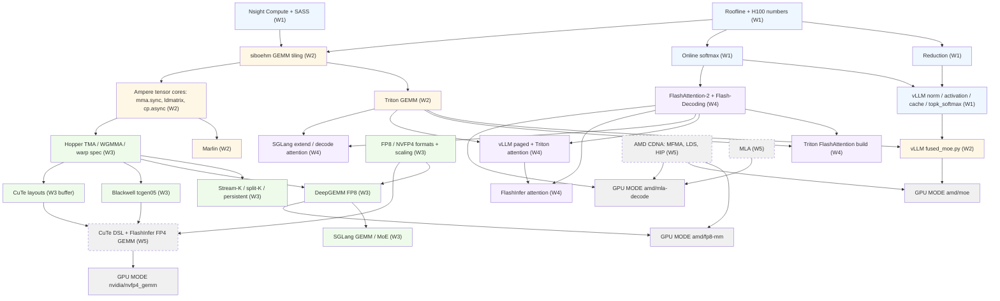

# Prerequisite graph

Each arrow means "must know before". Labels show the week each topic sits in. Every arrow points forward in time: no topic is read before its prerequisites. Dashed nodes in Week 5 are learned only if your chosen GPU MODE problem needs them.

## Changes from the earlier codebase-ordered plan

The earlier plan read vLLM and SGLang in Week 2, before GEMM (Week 3) and attention (Week 4). Six reading tasks came before their prerequisites, and five prerequisites were missing. The current plan fixes both:

- Production code now sits at the end of the week that teaches its algorithm.
- Added: Ampere tensor cores (W2), FP8/NVFP4 formats (W3), CuTe (W3 buffer).
- Moved to Week 5, only for the target that needs them: CuTe DSL and FlashInfer FP4 GEMM (NVIDIA problems), AMD architecture (AMD problems), MLA (`mla-decode`).
